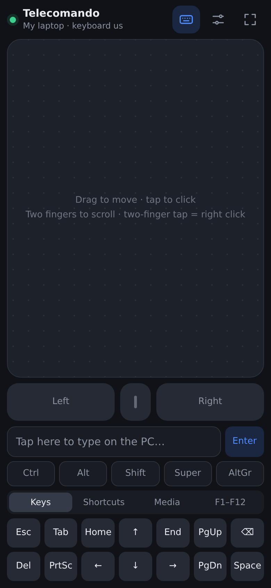
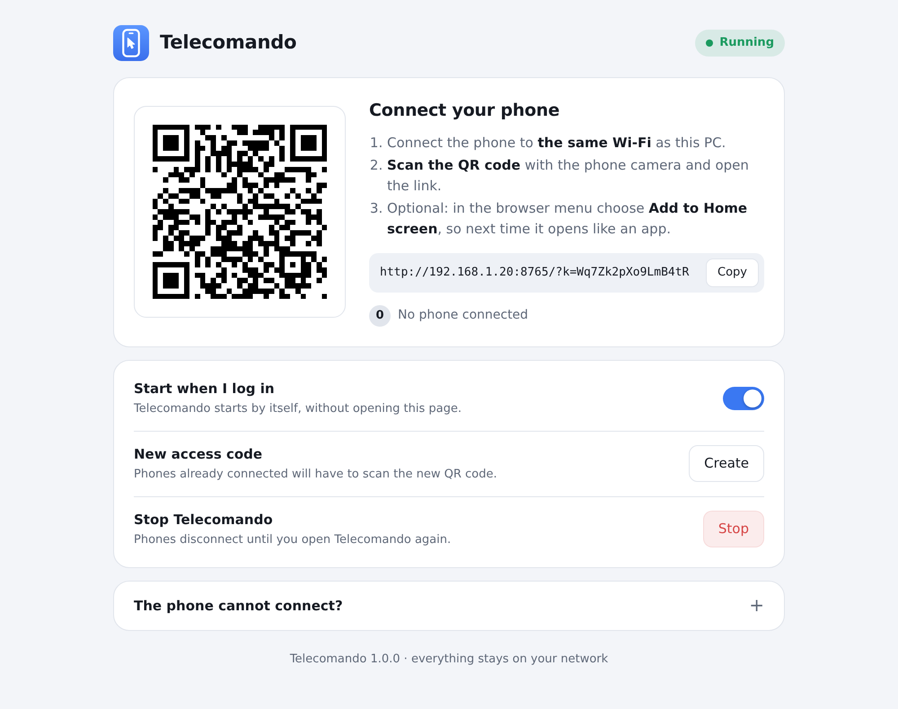

<p align="center"></p>

<h1 align="center">Telecomando</h1>

<p align="center">
  Usa il telefono come touchpad e tastiera del PC.<br>
  Windows e Linux · niente da installare sul telefono · niente esce dal tuo Wi-Fi
</p>

<p align="center"><a href="README.md">Read me in English</a></p>

<p align="center">
  
  &nbsp;&nbsp;
  
</p>

## Cosa fa

- **Touchpad**: muovi con un dito, tocca per cliccare, scorri con due dita (continua per inerzia), tocca con due dita per il tasto destro, tocca e trascina per selezionare.
- **Tastiera**: scrivi con la tastiera del telefono, compresi correttore, suggerimenti, dettatura, accenti ed emoji. In più Esc, frecce, F1–F12, Ctrl/Alt/Maiusc/Win (per un tasto o bloccati), comandi come copia, incolla e Alt+Tab, tasti multimediali e blocco schermo.
- **Si configura una volta**: inquadri il QR code la prima volta. Da lì in poi Telecomando parte con il PC, in background, e il telefono si collega da solo.
- **Nessuna app sul telefono**: è una pagina che il PC stesso offre al browser del telefono.
- **Privato**: telefono e PC parlano direttamente attraverso il tuo Wi-Fi. Niente account, niente cloud, niente pubblicità, nessun dato raccolto. Una volta scaricato, il programma è tutto tuo.

## Scarica e installa

Prendi l'ultima versione dalla **[pagina Releases](../../releases/latest)**.

### Windows 10 e 11

1. Scarica `Telecomando-…-windows-x64.zip`. Tasto destro sul file → *Proprietà* → spunta **Annulla blocco** → *OK*, poi estrailo (tasto destro → *Estrai tutto*) in una cartella dove resterà, ad esempio Documenti.
2. Apri **Telecomando.exe** nella cartella estratta.
   Se Windows dice *"PC protetto da Windows"* (il programma non è firmato con un certificato a pagamento), fai clic su **Ulteriori informazioni → Esegui comunque**.
3. Quando Windows chiede del firewall, consenti l'accesso sulle **reti private**.
4. Nel browser si apre una pagina con un QR code: inquadralo con il telefono, collegato allo stesso Wi-Fi.

Fatto. Da ora Telecomando parte da solo, in background, ogni volta che accedi al PC: non devi aprire niente.
Per rivedere la pagina con il QR code, riapri Telecomando.exe. Da quella pagina puoi anche fermare Telecomando, spegnere l'avvio automatico o creare un nuovo codice di accesso. Se sposti la cartella, apri una volta Telecomando.exe dalla nuova posizione.

### Linux

Per PC a 64 bit con una distribuzione recente (Ubuntu 22.04 o successive, Debian 12, Fedora, Linux Mint 21, …). Funziona su Wayland e X11, con qualsiasi desktop: GNOME, KDE Plasma, Xfce, Cinnamon…

1. Scarica `Telecomando-…-linux-x64.tar.gz` ed estrailo.
2. In un terminale, dentro la cartella estratta:
   ```sh
   ./install.sh
   ```
   Ti chiede la password una volta sola. Linux vuole un permesso prima che un programma possa creare un mouse e una tastiera virtuali; se c'è un firewall attivo (ufw o firewalld), la configurazione lascia anche che la rete di casa raggiunga Telecomando.
3. Alla fine nel browser si apre la pagina con il QR code: inquadralo con il telefono, collegato allo stesso Wi-Fi.

Fatto. Da ora Telecomando parte da solo ogni volta che accedi al PC. Per rivedere la pagina con il QR code, apri **Telecomando** dal menu delle applicazioni.

Per disinstallarlo: `~/.local/share/telecomando/uninstall.sh`

macOS non è supportato.

## Come si usa

| Sul telefono | Sul PC |
|---|---|
| Trascina un dito | Muove il puntatore |
| Tocco · doppio tocco | Clic · doppio clic |
| Tocca e poi trascina subito | Trascina, seleziona |
| Due dita | Scorre |
| Tocco con due / tre dita | Tasto destro / centrale |
| Icona tastiera, poi scrivi | Testo, con correttore e dettatura |
| Ctrl, Alt, Maiusc… una volta | Tenuto solo per il prossimo tasto |
| Ctrl, Alt, Maiusc… due volte | Bloccato: es. Alt bloccato, poi Tab, Tab… per scegliere la finestra |

Nel menu del browser del telefono scegli **Aggiungi a schermata Home**. Da lì in poi, quando il PC è acceso, tocchi quell'icona e il telefono si collega da solo, come un'app.
Nelle impostazioni (icona con i cursori) cambi velocità di puntatore e scorrimento, scorrimento naturale, tocco = clic e vibrazione.

Telecomando parte quando accedi al tuo account sul PC (subito all'accensione, se il PC entra da solo nell'account). Se il telefono non trova più il PC dopo un cambio di router o di rete, inquadra di nuovo il QR code: la pagina sul PC mostra sempre l'indirizzo attuale.

## Privacy e sicurezza

- Il telefono si collega **direttamente al tuo PC**. Non c'è un nostro server in mezzo e niente passa da internet.
- Telecomando accetta connessioni solo dalla **tua rete locale**, e solo dai telefoni che conoscono il **codice di accesso** contenuto nel QR code. Il codice è casuale e resta solo sul tuo PC; *Nuovo codice di accesso* lo sostituisce, e i telefoni devono inquadrare il nuovo QR code.
- La pagina con il QR code e le impostazioni si apre **solo sul PC stesso**.
- Dentro la tua rete la connessione non è cifrata (semplice HTTP, come per la maggior parte dei dispositivi che comandi in casa). Usa Telecomando su reti di cui ti fidi, come il Wi-Fi di casa, non sui Wi-Fi pubblici.

## Se qualcosa non va

**Il telefono non apre la pagina**
- Telefono e PC devono essere sullo stesso Wi-Fi (niente dati mobili, niente rete ospiti). Alcuni router tengono separati i dispositivi ("isolamento AP", "client isolation"): disattivalo.
- Windows: consenti Telecomando in *Sicurezza di Windows → Firewall e protezione della rete → Consenti app attraverso il firewall* per le reti **Private**, e imposta il Wi-Fi come **rete privata** (*Impostazioni → Rete e Internet → Wi-Fi → la tua rete*).
- Linux con un firewall diverso da ufw o firewalld: consenti la porta TCP 8765 dalla rete locale.

**Windows: alcune finestre ignorano il telefono.** Windows non lascia comandare le finestre aperte come amministratore (Gestione attività, programmi di installazione…). Avvia Telecomando come amministratore per comandare anche quelle.

**Linux: alcuni caratteri escono sbagliati.** Telecomando legge il layout della tastiera da GNOME, KDE o dalle impostazioni di sistema. Se sbaglia, indicalo tu, ad esempio `telecomando --layout de` oppure `telecomando --layout fr:azerty`.

**La porta è già usata da un altro programma.** Avvialo con un'altra, ad esempio `telecomando --port 8766` (su Linux esegui una volta `telecomando --setup --port 8766`, per il firewall).

## Opzioni da riga di comando

| Opzione | |
|---|---|
| `--port N` | porta di rete (predefinita 8765) |
| `--name NOME` | nome del PC mostrato sul telefono |
| `--layout LAYOUT` | Linux: layout di tastiera con cui scrivere, es. `de` o `fr:azerty` |
| `--new-code` | crea un nuovo codice di accesso |
| `--background` | parte senza aprire la pagina (usato per l'avvio all'accesso) |
| `--no-browser` | non apre la pagina nel browser |
| `--stop` | ferma la copia in esecuzione |
| `--autostart on` / `off` | avvio all'accesso sì o no |
| `--setup` / `--remove-setup` | Linux: permesso e firewall, da fare una volta, e loro rimozione |
| `--dry-run` | modalità prova: scrive cosa farebbe invece di muovere mouse e tastiera |

## Avviarlo dal codice sorgente

Serve solo Python 3.9 o successivo, nessun altro pacchetto:

```sh
git clone https://github.com/yeddaTech/telecomando
cd telecomando
python3 -m telecomando        # su Windows: py -m telecomando
```

Su Linux, la prima volta, esegui anche `python3 -m telecomando --setup`.
Avviato dal codice sorgente, Telecomando non attiva da solo l'avvio automatico: usa l'interruttore nella pagina del PC, oppure `--autostart on`.
Test: `python3 -m unittest discover -s tests`

## Creare i file da scaricare

```sh
python -m pip install pyinstaller
python build.py
```

Crea `dist/Telecomando-<versione>-windows-x64.zip` su Windows, oppure `dist/Telecomando-<versione>-linux-x64.tar.gz` su Linux.
Pubblicando un tag come `v1.0.0`, GitHub Actions li crea entrambi e li allega a una release ([release.yml](.github/workflows/release.yml)).

## Come funziona

Il PC esegue un piccolo server web, scritto solo con la libreria standard di Python. La pagina del telefono manda tocchi e tasti attraverso un WebSocket.

- Su **Windows** diventano input tramite l'API `SendInput`; il testo è inviato come caratteri Unicode, quindi funziona con qualsiasi layout di tastiera.
- Su **Linux** arrivano a un mouse e a una tastiera virtuali creati tramite `/dev/uinput`, ed è per questo che funziona anche su Wayland. Il testo è scritto con il layout di tastiera in uso, letto tramite libxkbcommon.

La struttura del codice è descritta nel [README in inglese](README.md#how-it-works).

## Licenza

MIT, vedi [LICENSE](LICENSE).
