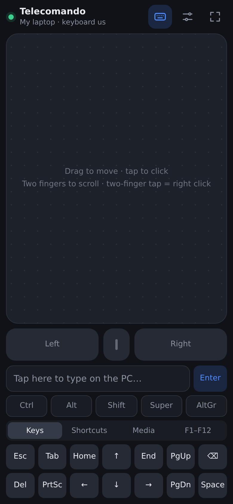
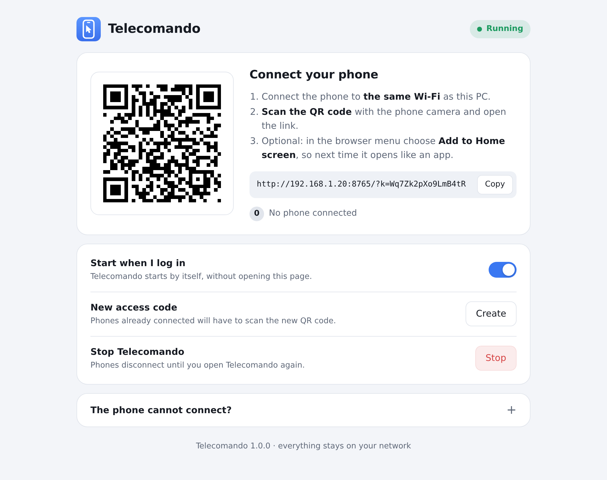

<p align="center"></p>

<h1 align="center">Telecomando</h1>

<p align="center">
  Use your phone as the touchpad and keyboard of your PC.<br>
  Windows and Linux · nothing to install on the phone · nothing leaves your Wi-Fi
</p>

<p align="center"><a href="README.it.md">Leggimi in italiano</a></p>

<p align="center">
  
  &nbsp;&nbsp;
  
</p>

## What it does

- **Touchpad**: move with one finger, tap to click, scroll with two fingers (it keeps going if you flick), tap with two fingers for a right click, tap and drag to select.
- **Keyboard**: type with the phone's own keyboard, autocorrect, suggestions, dictation, accents and emoji included. Plus Esc, arrows, F1–F12, Ctrl/Alt/Shift/Win (for one key or locked), shortcuts such as copy, paste and Alt+Tab, media keys and screen lock.
- **Set up once**: scan the QR code the first time. From then on Telecomando starts with the PC, in the background, and the phone connects by itself.
- **No app on the phone**: it is a page that your PC serves to the phone's browser.
- **Private**: phone and PC talk directly over your Wi-Fi. No account, no cloud, no ads, nothing collected. Once downloaded, the program is all yours.

## Download and install

Get the latest version from the **[Releases page](../../releases/latest)**.

### Windows 10 and 11

1. Download `Telecomando-…-windows-x64.zip`. Right click on it → *Properties* → tick **Unblock** → *OK*, then extract it (right click → *Extract All*) into a folder that will stay there, e.g. Documents.
2. Open **Telecomando.exe** in the extracted folder.
   If Windows says *"Windows protected your PC"* (the program is not signed with a paid certificate), click **More info → Run anyway**.
3. When Windows asks about the firewall, allow access on **private networks**.
4. A page opens in your browser with a QR code: scan it with your phone, connected to the same Wi-Fi.

That's all. From now on Telecomando starts by itself, in the background, every time you log in: there is nothing to open on the PC.
To see the page with the QR code again, open Telecomando.exe again. On that page you can also stop Telecomando, turn off the start at login or create a new access code. If you move the folder, open Telecomando.exe once from its new place.

### Linux

For 64-bit PCs with a recent distribution (Ubuntu 22.04 or later, Debian 12, Fedora, Linux Mint 21, …). It works on Wayland and X11, with any desktop: GNOME, KDE Plasma, Xfce, Cinnamon…

1. Download `Telecomando-…-linux-x64.tar.gz` and extract it.
2. In a terminal, inside the extracted folder:
   ```sh
   ./install.sh
   ```
   It asks for your password once. Linux wants permission before a program may create a virtual mouse and keyboard; if a firewall (ufw or firewalld) is on, the setup also lets your local network reach Telecomando.
3. At the end, the page with the QR code opens in your browser: scan it with your phone, connected to the same Wi-Fi.

That's all. From now on Telecomando starts by itself every time you log in. To see the page with the QR code again, open **Telecomando** from the applications menu.

To uninstall: `~/.local/share/telecomando/uninstall.sh`

macOS is not supported.

## Using it

| On the phone | On the PC |
|---|---|
| Drag one finger | Move the pointer |
| Tap · double tap | Click · double click |
| Tap, then drag right away | Drag, select |
| Two fingers | Scroll |
| Tap with two / three fingers | Right / middle click |
| Keyboard icon, then type | Text, with autocorrect and dictation |
| Ctrl, Alt, Shift… once | Held for the next key only |
| Ctrl, Alt, Shift… twice | Locked: e.g. lock Alt, then Tab, Tab… to pick a window |

In the phone browser's menu choose **Add to Home screen**. From then on, whenever the PC is on, tap that icon and the phone connects by itself, like an app.
The settings (sliders icon) change pointer and scroll speed, natural scrolling, tap to click and vibration.

Telecomando starts when you log in to your account on the PC (right at power-on if your PC logs in by itself). If the phone stops finding the PC after a change of router or network, scan the QR code again: the page on the PC always shows the current address.

## Privacy and security

- The phone connects **directly to your PC**. There is no server of ours in between and nothing goes through the internet.
- Telecomando only accepts connections from **your local network**, and only from phones that know the **access code** inside the QR code. The code is random and stored only on your PC; *New access code* replaces it, and phones then have to scan the new QR code.
- The page with the QR code and the settings opens **only on the PC itself**.
- Inside your network the connection is not encrypted (plain HTTP, as with most devices you control at home). Use Telecomando on networks you trust, such as your home Wi-Fi, not on public Wi-Fi.

## Troubleshooting

**The phone cannot open the page**
- Phone and PC must be on the same Wi-Fi (no mobile data, no guest network). Some routers keep devices apart ("AP isolation", "client isolation"): turn that off.
- Windows: allow Telecomando in *Windows Security → Firewall & network protection → Allow an app through firewall* for **Private** networks, and set your Wi-Fi as a **private network** (*Settings → Network & internet → Wi-Fi → your network*).
- Linux with a firewall other than ufw or firewalld: allow TCP port 8765 from your local network.

**Windows: some windows ignore the phone.** Windows does not let normal programs control windows running as administrator (Task Manager, installers…). Start Telecomando as administrator to control those too.

**Linux: some characters come out wrong.** Telecomando reads the keyboard layout from GNOME, KDE or the system settings. If it gets it wrong, give it explicitly, e.g. `telecomando --layout de` or `telecomando --layout fr:azerty`.

**The port is already used by another program.** Start with another one, e.g. `telecomando --port 8766` (on Linux run `telecomando --setup --port 8766` once, for the firewall).

## Command line options

| Option | |
|---|---|
| `--port N` | network port (default 8765) |
| `--name NAME` | name of the PC shown on the phone |
| `--layout LAYOUT` | Linux: keyboard layout to type with, e.g. `de` or `fr:azerty` |
| `--new-code` | create a new access code |
| `--background` | start without opening the page (used when starting at login) |
| `--no-browser` | do not open the page in the browser |
| `--stop` | stop the copy that is running |
| `--autostart on` / `off` | start at login, or stop doing it |
| `--setup` / `--remove-setup` | Linux: one-time permission and firewall setup, and its removal |
| `--dry-run` | test mode: logs what would happen instead of moving mouse and keyboard |

## Run from source

Only Python 3.9 or later is needed, no other package:

```sh
git clone https://github.com/yeddaTech/telecomando
cd telecomando
python3 -m telecomando        # on Windows: py -m telecomando
```

On Linux, the first time, run `python3 -m telecomando --setup` too.
Started from the source code, Telecomando does not turn on the start at login by itself: use the switch on the PC page, or `--autostart on`.
Tests: `python3 -m unittest discover -s tests`

## Build the downloads

```sh
python -m pip install pyinstaller
python build.py
```

This creates `dist/Telecomando-<version>-windows-x64.zip` on Windows, or `dist/Telecomando-<version>-linux-x64.tar.gz` on Linux.
Pushing a tag such as `v1.0.0` makes GitHub Actions build both and attach them to a release ([release.yml](.github/workflows/release.yml)).

## How it works

The PC runs a small web server, written with the Python standard library only. The phone page sends touches and keys through a WebSocket.

- On **Windows**, they become input through the `SendInput` API; text is sent as Unicode characters, so every keyboard layout works.
- On **Linux**, they go to a virtual mouse and keyboard created through `/dev/uinput`, which is why it works on Wayland too. Text is typed with the keyboard layout in use, read through libxkbcommon.

```
telecomando/
  app.py            start-up, web pages, API of the PC page
  server.py         minimal HTTP and WebSocket server
  control.py        phone messages → mouse and keyboard actions
  input_windows.py  Windows (SendInput)
  input_linux.py    Linux (uinput and libxkbcommon)
  qr.py             QR code generator
  autostart.py      start at login (registry on Windows, XDG autostart on Linux)
  linux_setup.py    one-time permission and firewall setup on Linux
  web/              phone page, PC page, icons
```

## License

MIT, see [LICENSE](LICENSE).
